# Hey, I'm Crimson (=^･ω･^=)

**Founder of [Flamy Studio](https://flamy.studio) · Backend & Infrastructure**

Founder by choice, sysadmin by necessity.

<picture>
  <source media="(prefers-color-scheme: light)" srcset="https://skillicons.dev/icons?i=go,rust,py,php,ts,elixir,debian,docker,nginx,postgres,redis,bash&amp;theme=light&amp;perline=6">
  
</picture>

### A little about me

- Building Flamy Studio and collecting side projects.
- Automating things that probably didn't need automation.
- Most of my production code lives somewhere else.

### Meanwhile, in production...

### Commit snack bar

<picture>
  <source media="(prefers-color-scheme: dark)" srcset="assets/snake-dark.svg">
  <source media="(prefers-color-scheme: light)" srcset="assets/snake-light.svg">
  
</picture>

*It works on my server.*
