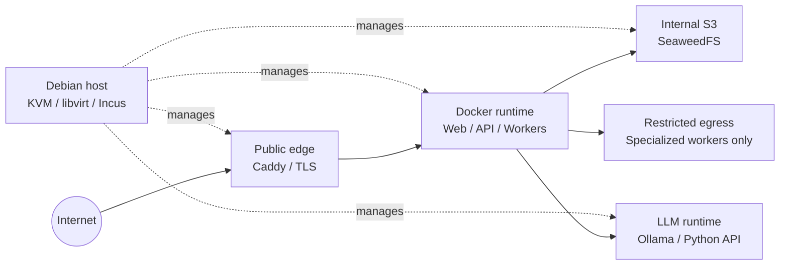

# Crimson

**Infrastructure & Reliability Engineer · Backend Engineer · Network Security**

Проектирую, развёртываю и сопровождаю production-инфраструктуру для web-сервисов, API, backend-систем и внутренних платформ. Основной фокус — Linux, виртуализация, container runtimes, сетевое разделение, controlled ingress/egress и воспроизводимые эксплуатационные процедуры.

Работаю в инфраструктуре и DevOps около 4 лет, в backend-разработке — около 2 лет. Представляю **Flamy studio**.

## Основные направления

- **Infrastructure & Reliability:** Debian, KVM/libvirt, Incus, Docker, Docker Compose, Caddy, nginx, systemd.
- **Network Security:** nftables, network segmentation, allowlist-модель, restricted egress, Suricata, Zenarmor.
- **Storage & Data Services:** SeaweedFS S3, PostgreSQL, Redis, project-specific databases.
- **LLM/ML Infrastructure:** отдельные runtime-узлы, GPU passthrough, Ollama, внутренние Python API.
- **Backend:** Go, Elixir, TypeScript, PHP, Rust.
- **Operations:** health checks, deployment runbooks, rollback procedures, диагностика и документирование инфраструктуры.

## Выбранные проекты

### [HY2XS_flamy](https://github.com/SashaAkana/HY2XS_flamy)

Проект на Go, подготовленный к открытой публикации. Репозиторий будет опубликован вместе с полной технической документацией, примерами конфигурации и эксплуатационными инструкциями.

### [flamy-infrastructure](https://github.com/SashaAkana/flamy-infrastructure)

Обезличенный архитектурный case study production-инфраструктуры: public edge, Docker runtime, внутреннее S3-хранилище, LLM runtime, network isolation и выделенный egress-контур.

### [engineering-case-studies](https://github.com/SashaAkana/engineering-case-studies)

Описание архитектурных решений и моей зоны ответственности в закрытых коммерческих и внутренних проектах без публикации proprietary source code, credentials и production topology.

## Текущая production-схема

В публичных материалах намеренно не раскрываются реальные адреса, credentials, management endpoints и полные production runbooks.

## Инженерные принципы

- public ingress проходит через единственный контролируемый edge;
- приложения не запускаются непосредственно на infrastructure host;
- базы данных, S3, LLM API и management interfaces не публикуются наружу;
- доступ между узлами предоставляется по минимально необходимой allowlist-модели;
- специализированный egress выдаётся только тем workers, которым он действительно нужен;
- изменения проходят через version control, validation, health checks и заранее определённый rollback path;
- документация рассматривается как часть production-системы, а не как необязательное дополнение.

## Закрытые проекты

Часть моей работы находится в private repositories и не может быть опубликована целиком. Для таких систем публикуются только обезличенные case studies: контекст задачи, архитектура, принятые решения, reliability/security-практики и зона моей ответственности.

| Проект | Основной стек | Доступность кода |
|---|---|---|
| `flamy_trade` | TypeScript | Private |
| `flamy_core` | Elixir | Private |
| `withen_eco` | PHP | Private |
| `CSK74_svelte` | Svelte | Private |
| `AWG2_harness` | Rust | Private |
| `HY2XS_flamy` | Go | Готовится к public release |
